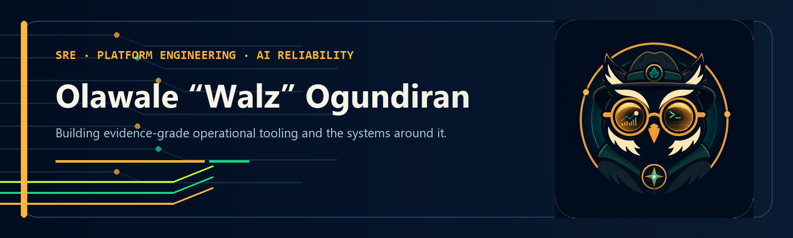

<p align="center">
  
</p>

<h1 align="center">Walz Ogundiran</h1>

<p align="center">
  <em>Senior SRE & Platform Engineer — Kubernetes Observability, AI-assisted Tooling & Cloud Operations</em><br/>
  <sub>Oxford, United Kingdom</sub>
</p>

<p align="center">
  <a href="https://www.linkedin.com/in/olawale-philips-ogundiran/">
    
  </a>
</p>

<p align="center">
  
  
  
  
  
  
  
  
</p>

---

5 years in site reliability and platform engineering, working on a production platform that
serves enterprise customers across Europe, the Americas, and Asia-Pacific.

I build tooling that makes Kubernetes observable and incidents shorter. My current focus is
AI-assisted SRE tooling — deterministic CLI tools that give agents inspectable cluster
evidence to reason over through MCP.

---

### What I'm building

| Project | Description | Status |
|---------|-------------|--------|
| **[kubectl-sentinel](https://github.com/GreenerPlatform/kubectl-sentinel)** | Point-in-time Kubernetes evidence across 15 health dimensions, with severity-ranked observations, provenance, and explicit collection status. Text, JSON, and HTML output. |  |
| **[incident-triage](https://github.com/GreenerPlatform/incident-triage)** | Rule-based correlation of an alert with a sentinel report. Produces ranked candidate causes, evidence gaps, and response steps for operator review. Python, standard library only. |  |
| **[greenerplatform-mcp](https://github.com/GreenerPlatform/greenerplatform-mcp)** | Thin MCP adapter that exposes both command-line tools to compatible hosts while leaving reasoning to the host agent. |  |

---

### Writing

**[AI Reliability Principles](https://www.linkedin.com/company/ai-reliability-principles/)** — a growing series on making AI dependable enough to trust with real operational decisions. It starts with deterministic-first — establish the facts, then let capable models reason over them — and adds principles as the work teaches them.

- Latest: [*Your AI is smart. Reliability needs it to be consistent.*](https://olawaleogundiran.medium.com/your-ai-is-smart-reliability-needs-it-to-be-consistent-496910033f0f) on Medium
- Follow the series on [LinkedIn](https://www.linkedin.com/company/ai-reliability-principles/) · all posts on [Medium](https://olawaleogundiran.medium.com)

---

### Open Source Contributions

| Project | Contribution | Status |
|---------|-------------|--------|
| **[percona-server-mongodb-operator](https://github.com/percona/percona-server-mongodb-operator/pull/2415)** | Inject a writable `/tmp` emptyDir for the mongod and backup-agent containers so `readOnlyRootFilesystem: true` works without CrashLoopBackOff. Version-gated, unit-tested. Addresses [#1793](https://github.com/percona/percona-server-mongodb-operator/issues/1793). |  |

---

### Domain Expertise

```
Kubernetes Observability    ██████████████████░░   Prometheus, Thanos, Grafana, Kiali, Istio
Incident Response           █████████████████░░░   PagerDuty, evidence correlation, incident classification
Platform Automation         ████████████████░░░░   Helm, ArgoCD, CI/CD pipelines, tenant provisioning
Cloud Operations            ██████████████░░░░░░   GCP, Azure, multi-region, cost optimisation
Security & Compliance       ████████████░░░░░░░░   RBAC, TLS, pod security, secrets hygiene
AI-assisted Tooling         ████████████░░░░░░░░   Dual-layer CLI + LLM reasoning pattern (building)
```

---

### What I've learnt building production SRE tooling

- **The dual-layer pattern** — a deterministic CLI layer that can run in CI, paired with an AI reasoning layer that explains *why*. Separating collection from reasoning improves portability and auditability.
- **Severity as an exit code** — `0/1/2` makes health checkers CI-composable. Think of them as HTTP status codes for shell tools.
- **Classify before you recommend** — OOMKill does not mean "raise the limit". The root cause determines the fix.
- **Evidence before reasoning** — collect inspectable cluster observations first, preserve gaps and uncertainty, then let the model reason within those bounds.

→ [GreenRanger-IT/learning-journal](https://github.com/GreenRanger-IT/learning-journal) — architecture decisions and engineering thinking from building production SRE tooling

---

<p align="center">
  <em>Building open-source reliability tooling for Kubernetes — inspectable evidence for AI-assisted operations. Open to collaborating on observability, incident response, and platform engineering.</em>
</p>

<p align="center">
  <a href="https://www.linkedin.com/in/olawale-philips-ogundiran/">
    
  </a>
</p>
